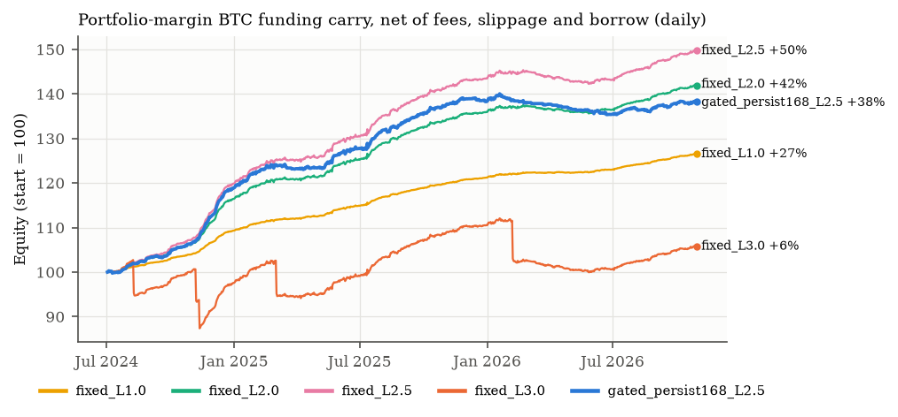
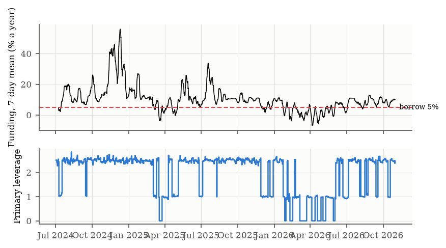

# Phase 1 report: the portfolio-margin funding carry on Hyperliquid BTC

Run on 2026-10-31. Reproduce with `python scripts/hl_carry_research.py --out experiments/carry_v1`
(offline from the run's cache). Trials were registered in `experiments/carry_v1/registry.json`
before the first backtest. Every table below is generated from `results.json`.

## Summary

- **The carry is a real, measurable edge.** Long UBTC spot and short the BTC perp under portfolio
  margin, always on at 1×, earned **+10.6%/yr with 1.2% volatility and a 0.3% maximum drawdown**
  from 2024-07 to 2026-10. That is net of taker fees, slippage and borrow. BTC buy-and-hold made
  −1.0%/yr with a 55% drawdown over the same window.
- **Leverage pays, up to a cliff the mathematics predicts.**
  - 2.5× earned **+18.9%/yr** (2.1% maximum drawdown, 0 liquidations).
  - 3.0× was **liquidated five times** (2024-08-08, 2024-11-06, 2024-11-11, 2025-03-02,
    2026-02-06) and earned +2.4%/yr.
  - The portfolio-margin formula says a 3× book dies on an +11.1% rally. The window had six days
    with intraday rallies above 10%, the largest +14.0% on 2026-02-06. 2.5× needs +33% and survived
    them all.
- **My pre-registered primary (forecast-gated, up to 2.5×) did worse than simply staying on**:
  +14.9% vs +18.9%. Gating paid $16.6k in fees against $3.7k, and the funding forecasts are not
  sharp enough to time a slow carry. The always-on books have been chosen *after* seeing results,
  so all nine trials are judged with the same deflated Sharpe ratio. The always-on books up to 2.5×
  remain at DSR ≈ 1.000; the primary is at 0.943 and always-on 3× at 0.000.
- **The edge is decaying.** Funding was +24% in 2024, +10.6% in 2025 and +5.4% in 2026 (annualized
  means). In 2026 it is barely above the 5% USDC borrow rate, so every leverage from 1× to 2.5×
  returns about +4.4% year-to-date. **Leverage only pays while funding exceeds the borrow rate.**

## 1. Venue facts checked for this phase

**Portfolio margin** (Hyperliquid docs, Trading > Portfolio margin):
- spot and perps are margined together;
- BTC is collateral at LTV 0.5, which gives a liquidation threshold of 0.75;
- the account is liquidatable when the ratio exceeds 0.95;
- USDC borrows cost 5% + 4.75 × max(0, utilization − 80%) APY;
- per-user caps are 200 BTC supplied and $50M USDC borrowed;
- account minimum: more than $10k of value.

The docs' own carry example is 1 BTC spot collateralizing a 1 BTC short. **Still to verify on
testnet:** whether portfolio margin is live on mainnet for our account, and which interpretation of
perp losses applies (below).

**Spot BTC** is UBTC/USDC (`@142`, Unit-bridged BTC), at about $16–36M a day against roughly $1.5B
on the perp. The spot leg is thinner, costs more (7 bp taker at tier 0) and carries bridge and
custody risk.

**API pitfall:** `spotMetaAndAssetCtxs` returns contexts that are **not** aligned with the
universe list by position. They must be joined on their `coin` field, or BTC shows up under
another token's name.

**Funding rules changed in 2023.** The documented hourly clamp formula reproduces 100% of prints
from 2024-01-01 on, but only 13–60% of 2023 prints, which were paid every 8 hours under a different
rule. Everything here uses 2024 onward.

## 2. Data

There are two panels:
- **Daily**, from 2024-07: perp candles, hourly funding summed per day, and UBTC spot, with the
  oracle implied by the premium as a proxy before UBTC traded.
- **Hourly**, from 2026-04-07: perp, UBTC and funding.

Every row carries its `known_at`.

**Data incident, caught and fixed.** UBTC's first days printed junk prices (6,969,696;
100,002,060), and on 2025-02-14 it *opened* at 240,000 before closing at 97,578. The first filter
checked closes only, so a leveraged book "bought" spot at 240,000 and showed impossible returns.
Every OHLC field is now checked against the perp's range ±2%, with a regression test.

Clean spot–perp basis: daily mean −0.4 bp (σ 6.4 bp, 1–99% range −13.8 to +15.4 bp); hourly
+1.7 bp (σ 6.1 bp). The basis is not where the risk is.

## 3. Forecasting funding

The models are scored out-of-sample (refit monthly, from 2024-07, about 20,400 hours). "Decision
hit" asks whether the forecast correctly says if funding will beat the 5% borrow rate.

| Model | 24 h R² vs 7-day persistence | 24 h decision hit | 7 d R² | 7 d decision hit |
|---|---|---|---|---|
| persist24 | +0.123 | 82.2% | -0.662 | 79.7% |
| persist168 | +0.000 | 79.9% | +0.000 | 82.6% |
| clamp_ar | +0.152 | 76.2% | -0.918 | 78.2% |
| clamp_ar_local | -0.248 | 66.3% | -1.343 | 65.1% |
| ridge | +0.369 | 84.3% | -0.007 | 81.5% |

- **The clamp-band structural model loses at the 7-day horizon.** Hyperliquid funding moves in
  persistent regimes that a Gaussian AR(1) on the premium (18-hour half-life) mean-reverts too fast.
  Re-centering it on a local level made it worse. This is reported as a negative result.
- **Ridge regression helps at 24 hours** (R² +0.37), but a carry is held for weeks.

## 4. Portfolio-margin mathematics (new results)

With leverage L as notional per side over equity, and perp maintenance margin m = 1.25%:
- the entry ratio is (m·L + L − 1)/(0.75·L);
- **the largest L at entry is 1/(1 − 0.95 + m + 0.95·0.25) = 3.33×**;
- because the perp's loss counts in full while the spot gain counts at 75%, **a rally, not a crash,
  liquidates a delta-neutral carry**. Under the strict interpretation (a perp loss is a borrow), the
  book dies at k* = 1/(L·(1 + m − 0.95·0.75)):

| L | Rally that liquidates without rebalancing |
|---|---|
| 1.5× | +122% |
| 2.0× | +67% |
| 2.5× | +33% |
| 3.0× | +11% |

The engine trims both legs back to the target once a rally has used half the distance to the
trigger. On daily bars it can only do so at the close, which is how 3× got caught intraday.

## 5. Results (daily, 2024-07-01 → 2026-10-30, $100k)

| Trial | Ann. return | Vol | Sharpe [95% CI] | Max DD | Liquidations | Mean L | Funding | Borrow | Fees | PSR | DSR |
|---|---|---|---|---|---|---|---|---|---|---|---|
| fixed_L1.0 | +10.6% | 1.2% | 8.78 [7.4, 10.2] | 0.3% | 0 | 1.00 | 27,384 | 220 | 662 | 1.000 | 1.000 |
| fixed_L1.5 | +13.4% | 1.7% | 7.34 [6.0, 8.7] | 0.7% | 0 | 1.50 | 42,740 | 7,016 | 1,707 | 1.000 | 1.000 |
| fixed_L2.0 | +16.2% | 2.3% | 6.55 [5.2, 7.9] | 1.4% | 0 | 2.00 | 59,017 | 14,653 | 2,600 | 1.000 | 1.000 |
| fixed_L2.5 | +18.9% | 2.9% | 6.07 [4.7, 7.4] | 2.1% | 0 | 2.50 | 76,224 | 22,923 | 3,732 | 1.000 | 1.000 |
| fixed_L3.0 | +2.4% | 11.1% | 0.28 [-0.8, 2.8] | 14.9% | 5 | 2.97 | 72,467 | 23,527 | 42,559 | 0.651 | 0.000 |
| gated_persist168_L2.0 | +13.2% | 2.3% | 5.42 [4.0, 7.0] | 2.7% | 0 | 1.62 | 53,952 | 9,745 | 11,738 | 1.000 | 0.993 |
| gated_persist168_L2.5 **(primary)** | +14.9% | 2.9% | 4.86 [3.5, 6.4] | 3.3% | 0 | 1.96 | 68,263 | 15,009 | 16,619 | 1.000 | 0.943 |
| gated_ridge168_L2.0 | +9.8% | 2.4% | 3.82 [2.2, 5.5] | 4.4% | 0 | 1.71 | 55,260 | 10,254 | 22,854 | 1.000 | 0.485 |
| gated_ridge168_L2.5 | +9.6% | 3.1% | 2.96 [1.3, 4.7] | 7.6% | 0 | 2.08 | 69,488 | 15,609 | 33,056 | 1.000 | 0.085 |

Return by calendar year:

| Trial | 2024 | 2025 | 2026 |
|---|---|---|---|
| fixed_L1.0 | +9.3% | +10.9% | +4.4% |
| fixed_L1.5 | +12.8% | +13.9% | +4.4% |
| fixed_L2.0 | +16.4% | +16.7% | +4.4% |
| fixed_L2.5 | +19.9% | +19.7% | +4.3% |
| fixed_L3.0 | -2.4% | +13.3% | -4.3% |
| gated_persist168_L2.0 | +15.9% | +14.4% | +0.7% |
| gated_persist168_L2.5 | +18.9% | +16.3% | -0.0% |
| gated_ridge168_L2.0 | +15.5% | +10.6% | -2.7% |
| gated_ridge168_L2.5 | +18.4% | +10.5% | -5.4% |

**Primary inference** (registered primary):
- PSR(0) = 1.000; **DSR over the nine trials = 0.943**.
- Stationary-bootstrap Sharpe 95% CI [3.4, 6.4]; annualized mean CI [+9.4%, +19.1%].
- Minimum track record about 41 days.

The Sharpe ratios are this high because the stream's daily volatility is tiny. They are an upper
bound: daily bars hide intraday basis noise.

## 6. Hourly validation (2026-04-07 → 2026-10-30)

| Hourly run (2026-04-07..) | Ann. return | Sharpe | Max DD | Max PM ratio | Deleverages |
|---|---|---|---|---|---|
| primary | +1.1% | 0.53 | 2.7% | 0.856 | 0 |
| fixed_L2.5 | +7.6% | 3.67 | 2.6% | 0.861 | 0 |
| fixed_L3.0 | +7.8% | 3.19 | 3.2% | 0.941 | 8 |

On hourly bars, with hourly trimming, 3× survives this calmer window, but its peak ratio was
**0.941 against a trigger of 0.95**. The cushion is 0.9%.

## 7. Sensitivities of the primary

| Primary under | Ann. return | Sharpe | Max DD | Liquidations |
|---|---|---|---|---|
| borrow 10% | +10.7% | 4.80 | 1.9% | 0 |
| borrow 20% | +8.8% | 5.52 | 1.9% | 0 |
| maker fills | +18.8% | 6.45 | 1.1% | 0 |
| fee tier 3 | +16.9% | 5.66 | 2.1% | 0 |
| PM interpretation: balance | +14.9% | 4.86 | 3.3% | 0 |

- **Borrow rate is the key risk.** Above 80% pool utilization the rate jumps by 4.75 points per
  point of utilization, e.g. 52.5% at 90%. We have no utilization history, so this is scenario
  analysis only.
- **Maker execution is worth about 4 points a year.**

## 8. What is not modeled

- borrow-rate spikes from utilization;
- portfolio-margin live status and caps (200 BTC per user, about $15M of spot at today's price);
- UBTC bridge, custody and depeg risk;
- auto-deleveraging;
- exchange or oracle incidents;
- intraday basis jumps (only bar extremes are checked);
- the liquidation penalty (assumed 1% of notional).

**Capacity** is bounded by UBTC spot liquidity: at 1% of daily volume, entries of roughly
$0.2–0.4M a day.

## 9. Conclusions and next steps

1. **Deployable candidate:** always-on carry at **2.0–2.5×**, a liquidation-quantile cap well below
   the 3.33× ceiling, trimming on rallies, and maker execution. Its selection is post-hoc, so it
   must pass the forward test before real size.
2. **Leverage rule:** let L > 1 only while expected funding exceeds the borrow rate plus a margin.
   Use a slow signal (30 days and up), not the weekly gate, which churned. This is a new trial, to
   be registered before it is run.
3. **Before any capital:**
   - testnet validation of the portfolio-margin ratio, to settle the interpretation;
   - a live check that portfolio margin is enabled;
   - an uncertainty buffer on the borrow cap.
4. **Remaining phase-0 items:**
   - Binance funding and OI loaders, giving a longer history for the funding model;
   - Deribit DVOL;
   - a forward recorder for Hyperliquid order book, open interest and borrow utilization (no
     history exists).
5. **Directional overlay (phase 2)** stays small. Its Kelly fraction is ≤ 1.3× (see PLAN_V2), and
   it should only be added if it improves the combined book's DSR.
